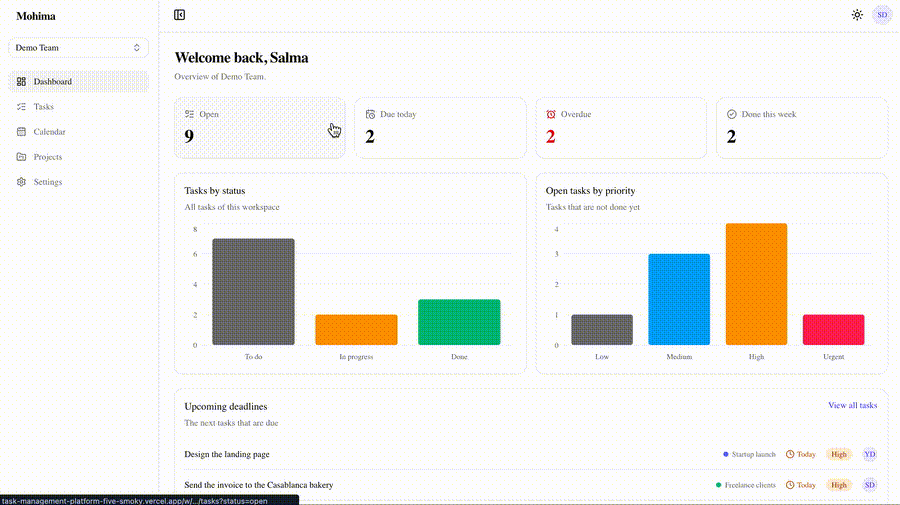
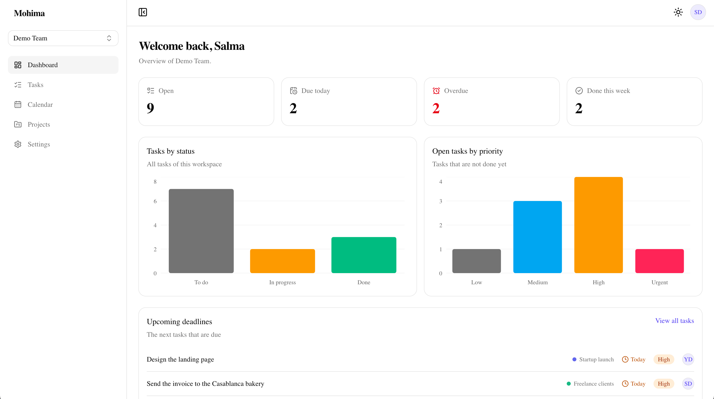
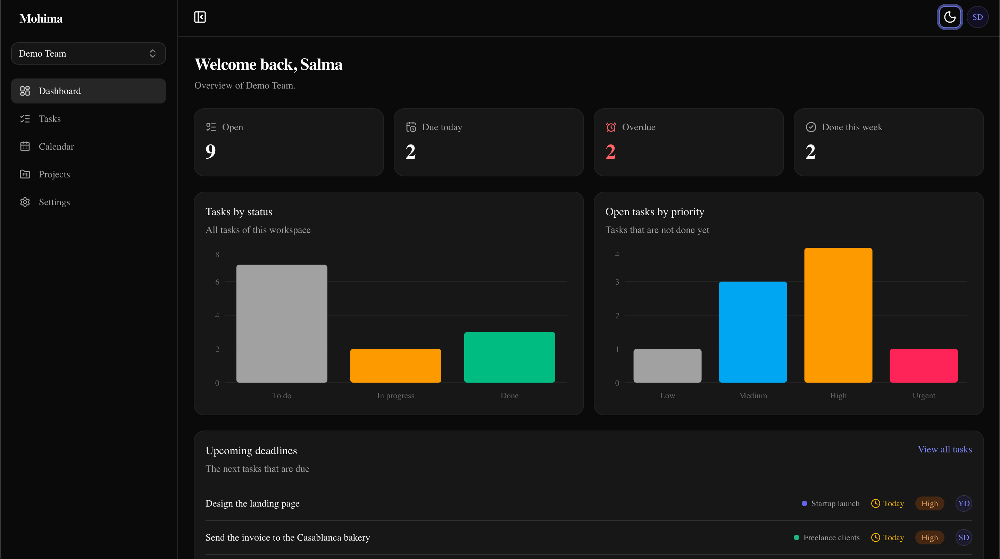
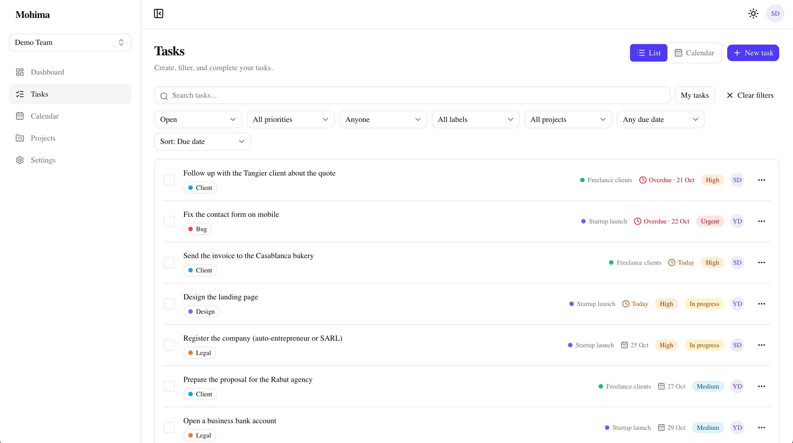
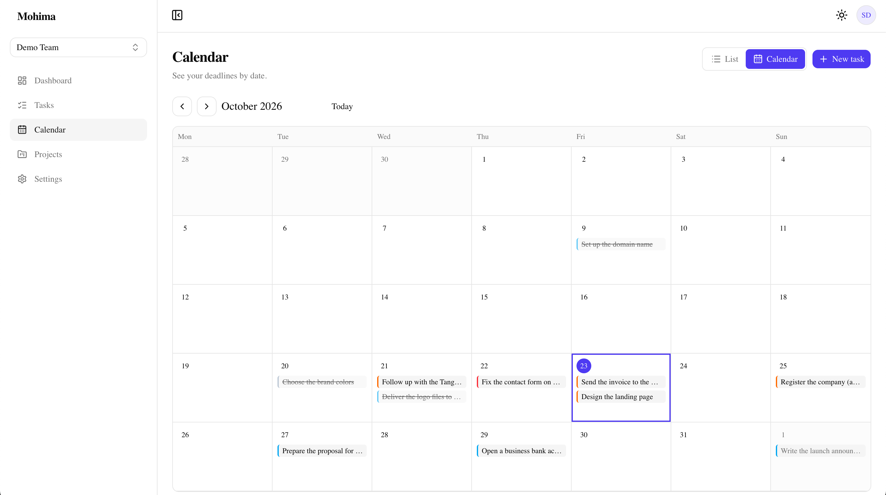
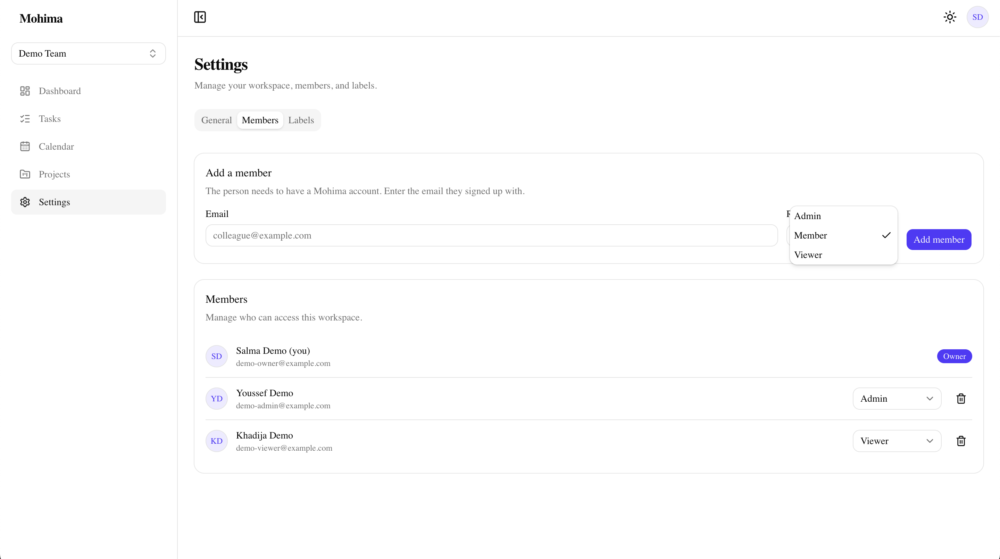
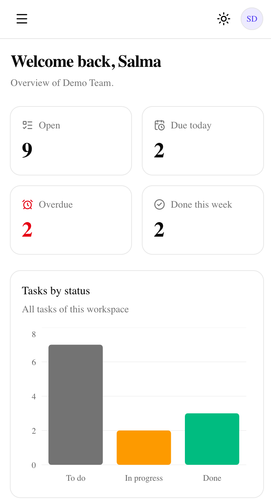
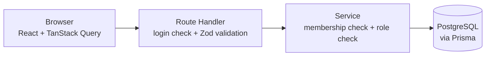
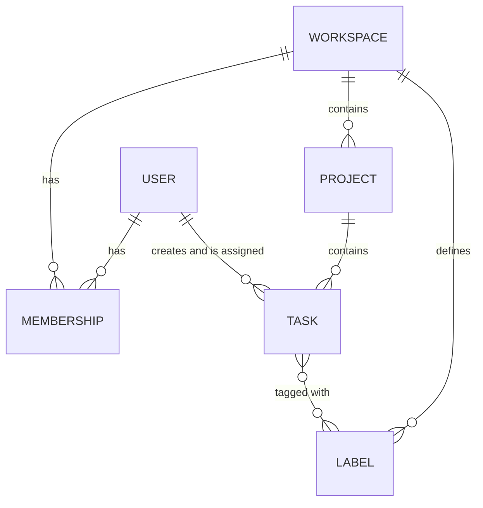

# Mohima

> A minimal, secure task management platform for students, freelancers and small teams.

[](https://github.com/abderrahimelouahhaby/task-management-platform/actions/workflows/ci.yml)

**Live demo: [https://task-management-platform-five-smoky.vercel.app](https://task-management-platform-five-smoky.vercel.app)**



## Try it in 30 seconds

Log in with one of these demo accounts (all use the same password: `Demo-Mohima-2026`):

| Account                   | Role   | What to try                                            |
| ------------------------- | ------ | ------------------------------------------------------ |
| `demo-owner@example.com`  | Owner  | Everything: tasks, labels, members, workspace settings |
| `demo-admin@example.com`  | Admin  | Manage projects, labels, and Members and Viewers       |
| `demo-viewer@example.com` | Viewer | Read only: no create, edit or delete controls          |

You can also sign up with your own email. Each account gets a private personal workspace. The demo data resets from time to time.

## Features

- **Personal and team workspaces** with four roles (Owner, Admin, Member, Viewer) and least-privilege permissions
- **Projects, tasks and labels**, with priority, status, due date and assignee
- **List view** with search, filters (status, priority, assignee, label, project, due date), sorting and pagination. Filters live in the URL, so a filtered list can be shared
- **Calendar view** (Monday first) with tasks on their due dates
- **Dashboard** with stat cards, charts and upcoming deadlines (cards link to the filtered list)
- **Optimistic updates**: ticking a task is instant, and rolls back if the server refuses
- **Light and dark mode**, responsive from phones to desktops, and keyboard and screen reader friendly

## Screenshots

| Dashboard                                     | Dashboard (dark)                                          |
| --------------------------------------------- | --------------------------------------------------------- |
|  |  |

| Tasks                                        | Calendar                              |
| -------------------------------------------- | ------------------------------------- |
|  |  |

| Members and roles                   | Mobile                                 |
| ----------------------------------- | -------------------------------------- |
|  |  |

## Tech stack

| Area         | Tools                                            | Why                                                               |
| ------------ | ------------------------------------------------ | ----------------------------------------------------------------- |
| Framework    | Next.js (App Router), React, TypeScript          | Frontend and API routes in one type-safe project                  |
| UI           | Tailwind CSS, shadcn/ui, Recharts, next-themes   | Fast, accessible, themeable components                            |
| Data         | PostgreSQL (Neon), Prisma 7                      | Type-safe database access and migrations                          |
| Auth         | Better Auth (email and password)                 | Hashed passwords, secure cookie sessions, rate limiting           |
| Validation   | Zod                                              | One schema for the form and for the API                           |
| Client state | TanStack Query, React Hook Form, Zustand         | Server data caching, forms, small UI state                        |
| Testing      | Vitest, Playwright, axe-core                     | Unit and integration tests, end-to-end tests, accessibility scans |
| Quality      | ESLint, Prettier, Husky, lint-staged, commitlint | Consistent code and Conventional Commits                          |
| DevOps       | GitHub Actions, Docker, Vercel                   | CI on every pull request, local database, automatic deploys       |

## Architecture

Every API request goes through the same small layers:



- **Routes are thin**: they check the session, validate the input with Zod, and call a service.
- **Services do the work and enforce permissions**, so a forgotten check in a route can never expose data, and the rules can be tested without HTTP.
- **One permission table** (`src/lib/permissions.ts`) is used by the server to enforce the rules and by the UI to hide buttons.

### Data model



### Roles

| Action                            | Owner | Admin |     Member      | Viewer |
| --------------------------------- | :---: | :---: | :-------------: | :----: |
| View everything                   |  Yes  |  Yes  |       Yes       |  Yes   |
| Create tasks                      |  Yes  |  Yes  |       Yes       |   No   |
| Edit a task                       |  Any  |  Any  | Own or assigned |   No   |
| Delete a task                     |  Any  |  Any  |       Own       |   No   |
| Projects and labels               |  Yes  |  Yes  |       No        |   No   |
| Add or remove Members and Viewers |  Yes  |  Yes  |       No        |   No   |
| Manage Admins and roles           |  Yes  |  No   |       No        |   No   |
| Rename or delete the workspace    |  Yes  |  No   |       No        |   No   |

## Security

Security was designed in from the start, following the OWASP Top 10, and it is **tested**:

| Risk                      | What I did                                                                                                                                                                                                                                                                                                                  |
| ------------------------- | --------------------------------------------------------------------------------------------------------------------------------------------------------------------------------------------------------------------------------------------------------------------------------------------------------------------------- |
| Broken access control     | Membership and role checks inside every service. Non-members get a 404 (the workspace's existence is never revealed). Every id from the browser (project, label, assignee) is checked to belong to the same workspace. IDOR tests, and end-to-end tests where a Viewer and a stranger are blocked in the UI **and** the API |
| Security misconfiguration | Content Security Policy and other security headers (tested), no `X-Powered-By`, environment variables validated with Zod at startup, no secrets in Git                                                                                                                                                                      |
| Supply chain              | Lockfile, Dependabot, `npm audit` in CI                                                                                                                                                                                                                                                                                     |
| Cryptographic failures    | Passwords hashed by Better Auth, HttpOnly + Secure + SameSite session cookie, HTTPS                                                                                                                                                                                                                                         |
| Injection                 | Prisma parameters, Zod validation on every input, no raw HTML, a test with a SQL injection string                                                                                                                                                                                                                           |
| Insecure design           | Least-privilege roles, field whitelists (no mass assignment), caps on page size, calendar range and text length                                                                                                                                                                                                             |
| Authentication failures   | Generic login errors, session expiry, minimum password length, database-backed rate limiting on sign in and sign up                                                                                                                                                                                                         |
| Integrity failures        | Origin checks (CSRF), `application/json` required for API bodies, CI must pass before merging                                                                                                                                                                                                                               |
| Logging                   | Refused requests (401 and 403) are logged as one JSON line, without passwords or tokens                                                                                                                                                                                                                                     |
| Exceptions                | Generic 500 message for users, details only in the server log                                                                                                                                                                                                                                                               |

**Known limitations** (honest list): the CSP still allows inline scripts (a nonce-based CSP is the next step), and there is no email verification, password reset or two-factor authentication yet.

## Testing

- **Unit tests** (Vitest) for the permission matrix, validation schemas, date helpers and query builders
- **Integration tests** (Vitest + a real PostgreSQL) for every service: roles, IDOR checks, filters, pagination, stats and calendar, with fixed dates so they never depend on the real date
- **End-to-end tests** (Playwright): search and filter, completing tasks, a Viewer blocked in UI and API, a 404 for strangers, every API route refusing visitors without a session, security headers, and **no CSP violations**
- **Accessibility scans** (axe-core) of every main page in light and dark mode
- **CI** (GitHub Actions) runs lint, type-check, formatting, tests, build and the end-to-end tests on every pull request

## Getting started

You need Node.js 22, Docker and Git.

```bash
git clone https://github.com/abderrahimelouahhaby/task-management-platform.git
cd task-management-platform
npm install

cp .env.example .env          # then set BETTER_AUTH_SECRET (openssl rand -base64 32)
docker compose up -d          # PostgreSQL on localhost:5432
npx prisma migrate dev        # create the tables
npm run db:seed               # demo data for development
npm run dev                   # http://localhost:3000
```

Development accounts (password `Password123!`): `salma@mohima.dev` (Owner), `youssef@mohima.dev` (Admin), `khadija@mohima.dev` (Viewer).

### Scripts

| Command                                        | What it does                                                    |
| ---------------------------------------------- | --------------------------------------------------------------- |
| `npm run dev`                                  | Start the app                                                   |
| `npm run build`                                | Production build                                                |
| `npm run lint` / `typecheck` / `format:check`  | Code quality checks                                             |
| `npm test`                                     | Unit and integration tests (needs the test database, see below) |
| `npm run test:e2e`                             | End-to-end tests (stop the dev server first)                    |
| `npm run db:migrate` / `db:seed` / `db:studio` | Database helpers                                                |
| `npm run db:migrate:test`                      | Apply migrations to the test database                           |
| `npm run db:seed-demo`                         | Create or reset the demo accounts (needs `DEMO_PASSWORD`)       |

Create the test database once: `docker compose exec db psql -U postgres -c "CREATE DATABASE mohima_test;"`, then `npm run db:migrate:test`.

## Project structure

```text
src/
├─ app/            Pages and API routes (Next.js App Router)
├─ components/     Shared UI (shadcn/ui in components/ui)
├─ features/       One folder per feature: schemas, hooks, components
├─ lib/            Permissions, dates, API client, query keys
├─ server/         Services, access checks, auth, database client
└─ stores/         Zustand store
prisma/            Schema, migrations, seed
e2e/               Playwright tests
```

## Future improvements

Comments and attachments, notifications and email, email verification and password reset, an activity log, a Kanban board with drag and drop, invitations by email, a nonce-based CSP, French and Arabic (RTL) support, and a mobile app with Expo using the same API.

## License

MIT
